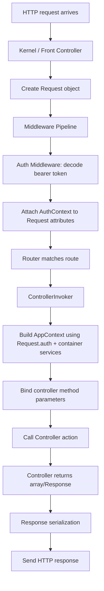
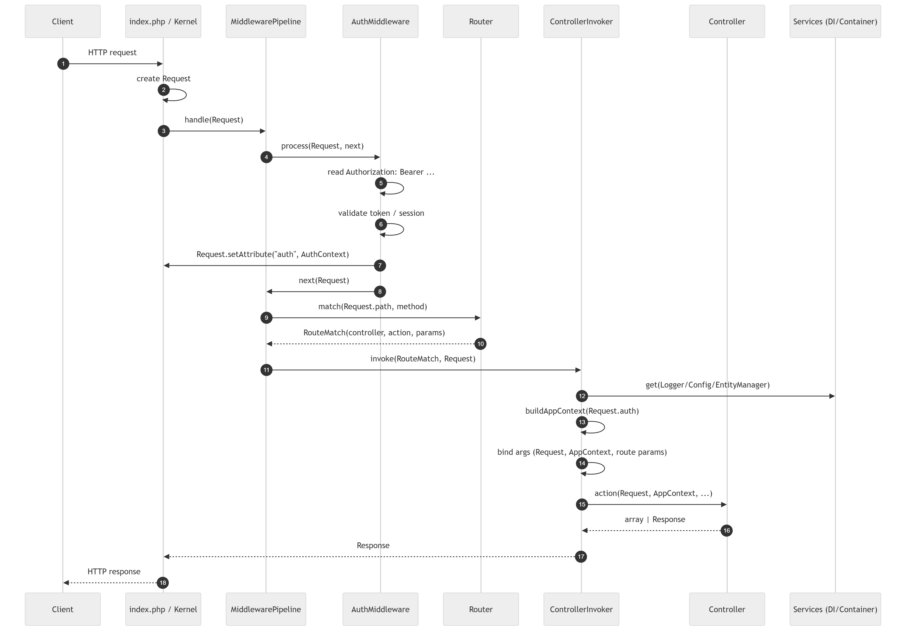

# Winglet HTTP Request Lifecycle
*(Middleware → ControllerInvoker → Controller)*

This document explains how an HTTP request flows through Winglet and why **request-scoped objects** (like `AuthContext` and `AppContext`) should be created **after middleware execution**, not injected via the controller constructor.

---

# 1. Scope Principles in Winglet

Understanding scope is essential for correct architecture.

## Application Scope (Container Scope)

Created during bootstrap and managed by the DI container.  
These may live for the entire application lifecycle.

Examples:
- `Config`
- `Logger`
- `EntityManager`
- Service classes

## Request Scope

Created per HTTP request and must never leak between requests.

Examples:
- `Request`
- `AuthContext`
- `AppContext`

Because `AppContext` contains `AuthContext`, it is inherently **request-scoped**.

---

# 2. High-Level Request Flow



# 3. Detailed Sequence Diagram


# 4. Why AppContext Should NOT Be Constructor-Injected

## Problem 1: AuthContext Does Not Exist Yet

Authentication typically happens in middleware:

1. Bearer token is decoded
1. Token is validated
1. AuthContext is attached to the Request

If AppContext is created in the controller constructor:

* It may receive an anonymous AuthContext
* It may not reflect the actual authenticated user

Correct auth information only exists after middleware has run.

##  Problem 2: Lifecycle Mismatch

* Controllers are container-managed (application-scope)
* AppContext is request-scoped

Injecting a request-scoped object into a potentially long-lived controller risks:

* Stale authentication data
* Scope leakage
* Hard-to-debug behavior

## Problem 3: Testability and Clarity

### Recommended (Method Injection)

```php
#[Route('/session', methods: ['GET'])]
public function getSession(Request $request, AppContext $ctx)
{
  // $ctx->auth always belongs to THIS request
}
```

This makes the request dependency explicit and easy to mock in tests.

### Not Recommended (Constructor Injection)

```php
public function __construct(private AppContext $ctx) {}
```

This hides request-scoped behavior inside a long-lived object.

# 5. Recommended Winglet Controller Pattern

## Constructor → Application Scope Only

```php
final class SessionManagement
{
    public function __construct(private SessionService $sessions) {}

```

## Action Method → Request Scope
```php
    #[Route('/session', methods: ['GET'])]
    public function getSession(Request $request, AppContext $ctx)
    {
        return $this->sessions->handle($ctx, $request);
    }
}
```

This ensures:

* Clean scope separation
* Correct authentication context
* Predictable behavior
* Easy testing
* Clear architectural intent
